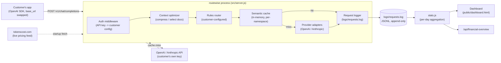

# routewise — System Design

Last updated: 2026-09-12

This describes the system as it actually exists on `main` today, not an aspirational future version. Where something is a known gap, it's called out explicitly rather than glossed over — see [CONTEXT.md](CONTEXT.md) for the prioritized list of what to build next.

## 1. Goals and non-goals

**Goals**
- Sit as a transparent proxy in front of a customer's own OpenAI/Anthropic usage.
- Reduce the customer's real, metered provider bill via two independent mechanisms: response caching and cost-based routing.
- Never touch the customer's provider billing relationship — they hold their own keys, we never see or resell their spend.
- Prove savings *before* asking for money (the dry-run tool), and make savings visible *after* going live (the dashboard).

**Non-goals (explicitly out of scope for the current system — see the original spec)**
- Automatic quality detection / model selection by "understanding" the request — routing is 100% rules the customer writes.
- Agent budget/governance controls (spend caps, loop detection, tool-call limits) — flagged as a possible future direction, not built.
- Payments/billing automation — handled manually (Stripe Payment Link / invoice) until there's real volume to justify it.
- Streaming responses, tool calls, `response_format` — the live endpoint explicitly rejects these today.

## 2. High-level architecture



**Everything lives in one Node.js process today.** No database, no separate cache service, no message queue. This is intentional for the pilot stage — see §9 for what has to change before it scales past one customer or one process.

## 3. Request lifecycle

This is the actual control flow inside `POST /v1/chat/completions` (`src/server.js`), including the parts added in the jeev-69 integration (context optimization, financial logging) and the fix applied during that merge (namespace-isolated semantic cache, not exact-hash).

```mermaid
sequenceDiagram
    participant App as Customer app
    participant Auth as authMiddleware
    participant Opt as optimizeContext()
    participant Router as selectRoute()
    participant Cache as SemanticCache
    participant Embed as Embedding provider
    participant Prov as Provider adapter
    participant Log as logRequestEvent()

    App->>Auth: POST /v1/chat/completions + Bearer key
    Auth->>Auth: look up customer by api_key
    alt invalid key
        Auth-->>App: 401
    end

    Auth->>Opt: messages, rw_optimization, customer.optimization
    Opt-->>Auth: optimized.messages, optimized.metrics
    Note over Opt: compress duplicate paragraphs,<br/>select docs within token budget,<br/>protected docs always kept verbatim

    Auth->>Router: promptText (from ORIGINAL messages), customer rules
    Router-->>Auth: { provider, model, matchedRule }
    Note over Router: first matching rule wins;<br/>x-force-model:flagship bypasses this entirely

    Auth->>Auth: build cacheNamespace =\nsha256(customer, requested model,\ntemperature, max_tokens, resolved route)

    alt cache enabled AND not forced flagship
        Auth->>Embed: embed(optimized prompt text)
        Embed-->>Auth: embedding vector
        Auth->>Cache: find(cacheNamespace, embedding, threshold)
        alt similarity >= threshold (same namespace only)
            Cache-->>Auth: cached response
            Auth->>Log: cache_hit=true, savings=full cost, optimization metrics
            Auth-->>App: 200 (cached content, rw_meta.cache_hit=true)
        end
    end

    Auth->>Prov: call with optimized.messages, resolved route.model
    Prov->>Prov: 60s timeout, 2 retries (SDK-level)
    Prov-->>Auth: completion + token usage
    Auth->>Cache: store(cacheNamespace, embedding, response)
    Auth->>Log: cache_hit=false, matched_rule, savings, financials
    Auth-->>App: 200 (rw_meta.cache_hit=false)
```

**Why the cache is namespaced the way it is:** a cache hit must never reuse an answer generated under different instructions, model, temperature, or resolved route. The namespace key folds all of that in; real embedding similarity search still runs *within* one namespace, so near-duplicate wording still hits — this combination was the fix applied when integrating jeev-69's branch, which had replaced real similarity matching with an exact-request hash (losing near-duplicate detection entirely). See the PR (#1) description for the full before/after.

## 4. Component reference

| Component | File(s) | Responsibility |
|---|---|---|
| Auth | `src/middleware/auth.js` | Resolves `Authorization: Bearer <key>` to a customer config entry. No sessions, no OAuth — the API key *is* the credential everywhere (proxy, dashboard, stats API). |
| Config loader | `src/config/loadConfig.js` | Reads `src/config/customers.yaml` once, caches in memory. **A config change requires a process restart** — no hot reload. |
| Context optimizer | `src/optimization/context.js` | Deduplicates paragraphs in reference documents (compression) and/or ranks+drops documents by lexical overlap with the question (selection), within a token budget. Protected documents are never dropped or altered. |
| Router | `src/router/rules.js` | Pure function: `(customer, promptText, forceFlagship) -> route`. Stateless, no I/O — fully unit-testable, which is why it has the most thorough test coverage. |
| Semantic cache | `src/cache/semanticCache.js` | In-memory `Map<namespace, entry[]>`. Cosine similarity search, TTL expiry, bounded to 1,000 total entries (oldest evicted first across all namespaces). |
| Embeddings | `src/cache/embeddings.js` | Two providers: real OpenAI `text-embedding-3-small`, or a free deterministic "mock" (bag-of-hashed-tokens) for offline testing. **The mock is known to overweight shared template phrasing** — confirmed via diagnostic to produce zero cross-topic false positives, but inflated hit-rate numbers on template-heavy synthetic data. Never treat a mock-embedding dry-run number as a real-world estimate. |
| Provider adapters | `src/providers/openai.js`, `src/providers/anthropic.js` | OpenAI is a passthrough. Anthropic translates the OpenAI-shaped request to the Messages API and translates the response back, so the customer's app never needs to know which provider actually served a given request. Both have a 60s timeout and 2 SDK-level retries. |
| Pricing | `src/logging/pricing.js` | Fetches live per-model $/token from tokenscost.com at startup (3s timeout, falls back to a small static table on failure or `PRICING_SOURCE=static`). Used for both the live `estimated_savings` field and the dry-run report. |
| Cost evaluation | `src/evaluation/*.js` | A *separate, opt-in* subsystem for proving savings against real paid calls with customer-confirmed rates. Fails closed: missing/unknown pricing is never treated as free. Idempotency-key protected against duplicate paid calls; one evaluation per customer at a time. |
| Logger | `src/logging/logger.js` | Appends one JSON line per completed request to `logs/requests.log`. Fire-and-forget (`fs.appendFile`, not awaited) — a crash between the response being sent and the write landing would lose that one log line, not the response itself. |
| Stats aggregator | `src/logging/stats.js` | Reads the whole log file on every call, filters by customer name, aggregates into daily buckets. **O(log size) per dashboard request** — fine at pilot scale, will need indexing or a real datastore once the log file is large. |
| Dashboard | `public/dashboard.html` + `/api/stats`, `/api/financial-overview` | Static HTML/CSS/vanilla JS, no build step, no framework. Client-side period filtering (7D/14D/30D/All) recomputes from the full daily breakdown already fetched — no re-fetch per filter change. |
| Dry-run tool | `scripts/dryRun.js` | Replays a JSONL request log through the *same* cache+router logic as the live server, with zero real provider calls. This is the sales-proof mechanism — it must stay behaviorally identical to `server.js`'s cache/router logic, or the numbers it produces stop meaning anything. |

## 5. Data model

**Customer config** (`src/config/customers.yaml`, one entry per customer):

```yaml
customers:
  - api_key: string              # credential for OUR proxy (not a provider key)
    name: string
    provider_keys: { openai, anthropic }   # the customer's own keys
    default: { provider, model }            # flagship fallback
    cache: { enabled, similarity_threshold, ttl_seconds }
    routing:
      rules: [{ name, match: { max_prompt_tokens, keywords }, route_to: { provider, model } }]
    optimization: { compression, selection, max_context_tokens }   # defaults for context optimization
    evaluation: { enabled, pricing: { "provider/model": { input, output, cached_input, source, as_of } } }
```

This file is loaded once at startup and is the single source of truth for every customer-specific decision (auth, routing, caching, pricing evaluation). It is gitignored — only `customers.example.yaml` is committed.

**Request log line** (`logs/requests.log`, one JSON object per line, append-only):

```json
{
  "timestamp": "ISO 8601",
  "customer": "string (name, not api_key)",
  "customer_sha256": "hex (hashed api_key, for correlation without storing the raw key)",
  "model_requested": "string",
  "model_used": "string",
  "cache_hit": "boolean",
  "similarity": "number (present only on cache hits)",
  "matched_rule": "string | null",
  "estimated_savings": "number (USD)",
  "financials": { "provider_spend_usd": "number | null", "source": "string" },
  "optimization": { "estimated_tokens_removed": "number", "context_documents_selected": "number", "..." }
}
```

This is the only persistent state in the system besides the in-memory cache. Everything the dashboard shows is derived from it.

## 6. Multi-tenancy and isolation

- **Cache isolation**: every cache entry lives under a namespace key that includes the customer's own API key — verified by test (`entries are namespaced per customer — no cross-customer leakage`). Additionally namespaced by model/temperature/max_tokens/route within a customer, so different settings can never share a cache entry (see §3).
- **Config isolation**: each customer's routing rules, provider keys, and pricing config are independent entries in the same YAML file — no shared state between customers at the config level.
- **Log isolation**: `stats.js` filters the shared log file by `customer` name per request — there's no per-customer log file, so a bug in that filter is the single biggest cross-tenant data-leak risk in the system today. It's covered by tests but hasn't been adversarially reviewed.
- **No authentication beyond the API key** — no rate limiting, no per-key scoping of permissions, no revocation flow. Anyone with a valid key has full access to that customer's proxy traffic and dashboard.

## 7. Failure modes

| Failure | Current behavior |
|---|---|
| Invalid/missing API key | 401, no further processing |
| Malformed request body | 400 with a specific message (missing `messages`, invalid `rw_optimization`, etc.) |
| Customer has no provider key configured for the resolved route | 500, `config_error` |
| Upstream provider call fails (bad key, rate limit, outage) | 502, `upstream_error`, the raw provider error message is passed through |
| tokenscost.com pricing fetch fails or times out (3s) | Silently falls back to the static pricing table; logged as a warning, not an error |
| Embedding call fails | Not currently caught separately — propagates as a 502 from the outer try/catch, same as any other upstream failure |
| Process restart | In-memory cache is fully lost; log file and config on disk are unaffected |
| Log write fails (disk full, permissions) | Logged to console, response to the customer is unaffected — **the customer never sees a failure caused by our own logging** |

There is no circuit breaker, no retry budget across requests, and no fallback provider if one is down — each request either succeeds or returns a 502 to the customer's app.

## 8. Observability

- **Structural**: one flat JSONL file, no rotation, no size cap, no shipping to an external log system.
- **Metrics**: none beyond what's derivable from the log file via `stats.js` — no request-rate, latency, or error-rate metrics tracked anywhere.
- **Alerting**: none. A provider outage or a config error affecting one customer would only be noticed by that customer, or by someone manually watching server console output.
- **Tracing**: none — no correlation ID threading a single logical request through cache lookup, provider call, and log write (though in practice it's all synchronous within one request handler, so this matters less than it would in a distributed system).

## 9. What has to change before this scales

In priority order (matches [CONTEXT.md](CONTEXT.md)'s roadmap, expanded with the "why" from a systems perspective):

1. **CI running `npm test` on every PR.** Zero infrastructure risk in adding this; directly would have caught the caching regression from the jeev-69 merge before it needed a manual audit.
2. **Persistent, shared cache (Redis + pgvector/Qdrant).** The in-memory `Map` in `semanticCache.js` is the single hardest architectural constraint in the system: it means (a) a restart loses all cached value, and (b) you cannot run more than one server process, because two processes would have two disjoint caches and neither would see the other's hits. This blocks horizontal scaling entirely, not just "would be nice to have."
3. **Move `customers.yaml` to a real config store** (database or a config service) with hot reload or an admin API. At more than a handful of customers, editing a YAML file and restarting the process for every config change stops being viable.
4. **Rate limiting / per-customer usage caps**, enforced at the proxy layer — currently nothing stops runaway usage from a bug or a leaked key.
5. **Log to something queryable**, not a flat growing file — `stats.js`'s full-file-scan-per-request approach degrades linearly with log size and has no index.
6. **Streaming support.** Structurally this is the biggest gap for real adoption — the whole request/response model in `server.js` assumes one request in, one JSON response out. Adding streaming means threading the optimize→route→cache-check→provider-call pipeline through a streamed response instead of a buffered one, and deciding what "cache hit" even means for a stream (replay it as a fake stream? Return it as one chunk?).
7. **Secrets out of a plaintext YAML file** — provider keys need a real secrets manager before any real customer's credentials go in this file.

None of this is needed to serve the current single pilot customer scenario. It becomes necessary in roughly the order listed as soon as there's more than one paying customer or any real production load.
